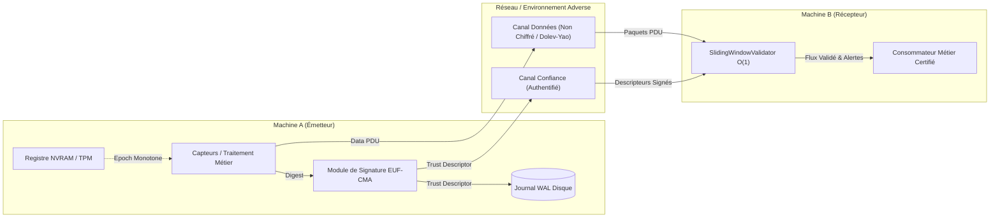
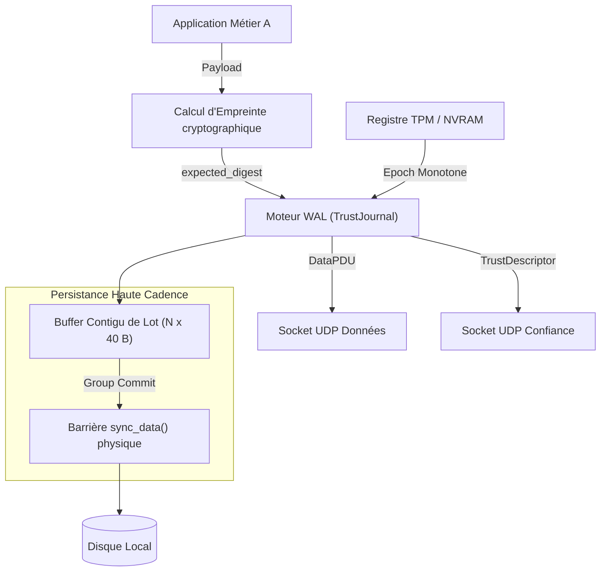
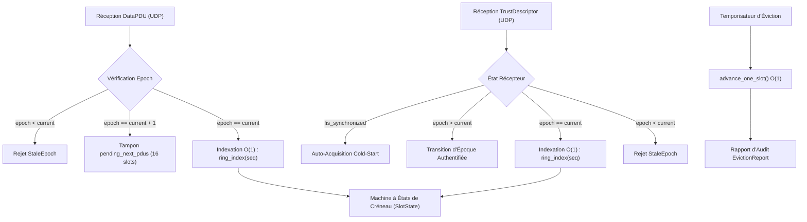
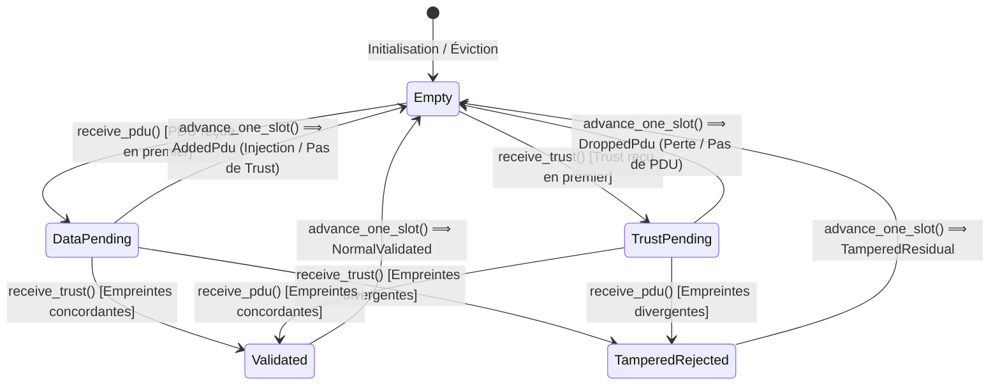

# Spécification et Architecture Système : AI-Trust

**Document de Conception et d'Architecture Technique (DDA / SRS)**  
**Niveau de Sûreté Ciblé :** DO-178C DAL A / ISO 26262 ASIL D / Critères Communs EAL 7  
**Projet :** AI-Trust — Automate Formellement Vérifié de Validation de Flux Réseau Asynchrone Haute Cadence  
**Référence d'Implémentation :** [`src/lib.rs`](file:///Users/jean-baptiste/AI-Trust/src/lib.rs)  
**Moteur de Preuve Formelle :** Verus (Logique de Hoare & SMT / Z3 intégré en Rust)

---

## 1. Introduction et Objectifs Système

### 1.1 Contexte Opérationnel
Dans les systèmes critiques distribués (systèmes de mission de défense, liaisons radar, guerre électronique, avionique modulaire intégrée), deux équipements (Machine A émettrice et Machine B réceptrice) s'échangent des flux de données critiques à haute fréquence sur des canaux de communication asynchrones, potentiellement bruités, instables ou hostiles.

L'architecture **AI-Trust** découple la transmission des données de leur certification d'intégrité :
1. **Canal de données $\mathcal{C}_{\text{data}}$** : Achemine les paquets applicatifs métiers (`DataPdu`). Ce canal peut être asynchrone, soumis à une forte gigue (*jitter*), du désordre, des pertes de paquets ou des attaques actives.
2. **Canal de confiance $\mathcal{C}_{\text{trust}}$** : Achemine des descripteurs d'intégrité signés numériquement (`TrustDescriptor`).



### 1.2 Objectif de Sécurité et de Sûreté
L'objectif central est d'assurer la **détection exhaustive, déterministe et exclusive** de toute anomalie de transmission :
- **Altération (*Tampering*)** : Altération d'un ou plusieurs bits de la charge utile en vol.
- **Duplication (*Replay*)** : Réinjection malveillante ou accidentelle de paquets légitimes passés (intra-session ou inter-sessions).
- **Injection (*Spurious / Added*)** : Insertion de trames illégitimes non émises par Machine A.
- **Suppression (*Drop / Loss*)** : Perte réseau ou déni de service ciblé.

---

## 2. Exigences Système (SRS)

### 2.1 Exigences Fonctionnelles (EF)
- **EF-01 (Corrélation Temporelle Asynchrone Bidirectionnelle) :**  
  L'automate doit être capable de corréler une PDU et son descripteur quel que soit leur ordre d'arrivée sur le réseau (PDU avant Trust ou Trust avant PDU).
- **EF-02 (Éviction et Audit en Temps Constant $O(1)$) :**  
  L'avancement de la fenêtre doit classifier chaque créneau expiré de manière univoque (`NormalValidated`, `DroppedPdu`, `AddedPdu`, `TamperedResidual`, `None`) en temps constant strict sans décalage mémoire.
- **EF-03 (Persistance et Résilience aux Pannes de l'Émetteur) :**  
  L'émetteur doit persister tout descripteur émis dans un journal *Write-Ahead Log* (WAL) sur support non-volatile, résistant aux coupures d'alimentation intempestives.
- **EF-04 (Immunité au Rejeu Inter-Sessions par Registre Matériel Monotone) :**  
  À chaque cycle de démarrage ou redémarrage de Machine A, un compteur d'époque monotone non-volatile doit être incrémenté. Machine B doit rejeter immédiatement tout paquet issu d'époques antérieures.
- **EF-05 (Survie au Remplacement Physique de Disque) :**  
  La destruction ou le remplacement du disque dur de Machine A par un disque vierge ne doit pas réinitialiser l'époque à zéro : l'époque doit être adossée à un registre matériel hors-disque (NVRAM / TPM).
- **EF-06 (Auto-Acquisition au Démarrage à Froid de Machine B) :**  
  Au boot initial ou après redémarrage de Machine B, l'automate doit auto-synchroniser dynamiquement son époque et sa base de séquence dès réception du premier descripteur de confiance signé, sans état persistant préalable requis sur B.
- **EF-07 (Tolérance aux Salves de Pré-Époque) :**  
  Lors d'une transition d'époque, l'automate récepteur doit être capable d'absorber une salve de paquets de la nouvelle époque arrivant avant le premier descripteur de cette époque (tampon d'attente de 16 créneaux).

### 2.2 Exigences Non-Fonctionnelles (ENF)
- **ENF-01 (Complexité Temporelle Strictement Déterministe) :**  
  Toutes les opérations d'insertion, de corrélation et d'éviction s'exécutent en temps constant $O(1)$, sans boucle dépendante de la taille de la fenêtre $W$.
- **ENF-02 (Haute Cadence via Group Commit) :**  
  La persistance disque doit supporter le *Group Commit* par lots contigus (`append_batch`) avec amortissement du coût de synchronisation matérielle (`sync_data`), permettant une cadence $\ge 100\,000\text{ paquets/sec}$.
- **ENF-03 (Zéro Panique & Zéro Allocation Dynamique sur le Chemin Critique) :**  
  Code garanti sans panique (`#![forbid(unsafe_code)]`, `#![deny(clippy::panic)]`, zéro `unwrap()`, zéro `expect()`), avec structures à taille fixe allouées statiquement.
- **ENF-04 (Vérification Formelle Intégrale) :**  
  Toutes les propriétés de sûreté, de monotonie, d'invariance d'indice et de résilience aux pannes doivent être formellement prouvées par SMT (Verus / Z3).

---

## 3. Architecture Détaillée des Composants

### 3.1 Émetteur (Machine A)



L'émetteur se compose de trois modules fondamentaux :
1. **Compteur d'Époque Matériel (`HardwareMonotonicCounter`) :**  
   Interface d'accès au registre non-volatile soudé sur la carte mère (registre NV de puce TPM 2.0 ou EEPROM sécurisée).  
   Fournit la primitive atomique `fetch_and_increment()` qui garantit la stricte croissance :
   $$\text{epoch}_{t+1} = \text{epoch}_t + 1$$
   Même en cas de destruction physique ou remplacement du disque dur, le compteur matériel assure la séparation stricte des espaces de séquence.

2. **Journal Persistant Résistant aux Crashs (`TrustJournal`) :**  
   Implémente le patron de conception *Write-Ahead Logging* (WAL).  
   Chaque enregistrement scelle 40 octets alignés sur disque :
   - `magic` : Constante magique `0x5452_5553` ("TRUS").
   - `padding` : 4 octets nuls pour alignement mémoire 64 bits.
   - `epoch` : Entier non signé 64 bits Big-Endian.
   - `seq` : Numéro de séquence 64 bits Big-Endian strictement croissant.
   - `expected_digest` : Condensat de la charge utile certifiée.
   - `checksum` : Somme de contrôle arithmétique d'intégrité disque.

3. **Moteur de Group Commit (`append_batch`) :**  
   Pour pallier le coût rédhibitoire de l'appel système `sync_data()` par paquet (~1 ms sur SSD), le moteur regroupe un lot de $N$ descripteurs dans un tampon mémoire contigu de taille $N \times 40$ octets. Une seule écriture physique et une seule commande de synchronisation sont émises, divisant le coût temporel par $N$.

---

### 3.2 Récepteur (Machine B)



Le récepteur repose sur la structure [`SlidingWindowValidator`](file:///Users/jean-baptiste/AI-Trust/src/lib.rs#L340-L365) :
- **Tableau Circulaire Direct (`slots: [SlotState; 4096]`) :**  
  Tableau statique de 4096 créneaux alloués en mémoire contiguë.  
  L'indexation physique s'effectue en temps constant $O(1)$ par calcul de reste modulaire :
  $$\text{ring\_index}(\text{seq}) = \text{seq} \pmod{4096}$$
  L'injectivité intra-fenêtre est garantie formellement par le lemme `lemma_ring_buffer_injectivity`.

- **Arithmétique Circulaire RFC 1982 :**  
  Les calculs d'appartenance à la fenêtre utilisent la distance modulaire sur 64 bits :
  $$\Delta = \text{seq}.\text{wrapping\_sub}(\text{window\_base})$$
  - $\Delta < 4096$ : créneau situé dans la **fenêtre active**.
  - $4096 \le \Delta < 2^{63}$ : créneau situé dans le **futur hors-fenêtre** (`OutOfWindow`).
  - $\Delta \ge 2^{63}$ : créneau situé dans le **demi-espace passé** (`Duplicated` / rejeu).
  Le partitionnement ensembliste strict est prouvé par `theorem_circular_space_partition`.

- **Tampon de Transit de Pré-Époque (`pending_next_pdus: [Option<DataPdu>; 16]`) :**  
  File statique de 16 créneaux permettant de retenir les paquets de l'époque future ($\text{epoch} = \text{current} + 1$) ou reçus avant synchronisation initiale lors d'un démarrage à froid.

---

## 4. Machine à États d'un Créneau (Slot Lifecycle)

Chaque créneau de la fenêtre glissante circulaire implémente l'automate d'états suivant :



### Table des Transitions d'États

| État Initial | Événement Réseau Déclencheur | Condition de Garde | Nouvel État | Résultat Immédiat Émis |
| :--- | :--- | :--- | :--- | :--- |
| `Empty` | `receive_pdu(pdu)` | PDU dans la fenêtre | `DataPending { computed_digest }` | `BufferedWaitingForTrust` |
| `Empty` | `receive_trust(trust)` | Trust dans la fenêtre | `TrustPending { expected_digest }` | `BufferedWaitingForPdu` |
| `DataPending` | `receive_trust(trust)` | `computed_digest == expected_digest` | `Validated { digest }` | `CorrelatedValid` |
| `DataPending` | `receive_trust(trust)` | `computed_digest != expected_digest` | `TamperedRejected` | `CorrelatedTampered` |
| `TrustPending` | `receive_pdu(pdu)` | `computed_digest == expected_digest` | `Validated { digest }` | `CorrelatedValid` |
| `TrustPending` | `receive_pdu(pdu)` | `computed_digest != expected_digest` | `TamperedRejected` | `CorrelatedTampered` |
| `Validated` | `receive_pdu(pdu)` | Séquence déjà vue | Inchangé | `Duplicated` (Rejeu) |
| `DataPending` | `receive_pdu(pdu)` | Séquence déjà vue | Inchangé | `Duplicated` (Rejeu) |
| `TrustPending` | `receive_trust(trust)`| Descripteur déjà vu | Inchangé | `RedundantTrust` |
| `Tout État` | `advance_one_slot()` | Avancement temporisé | `Empty` | Émission d'un `EvictionReport` |

---

## 5. Spécification des Formats Wire et Disque

### 5.1 Format Wire d'une Data PDU (Canal non sécurisé - 24 octets)
```
 0                   1                   2                   3
 0 1 2 3 4 5 6 7 8 9 0 1 2 3 4 5 6 7 8 9 0 1 2 3 4 5 6 7 8 9 0 1
+-+-+-+-+-+-+-+-+-+-+-+-+-+-+-+-+-+-+-+-+-+-+-+-+-+-+-+-+-+-+-+-+
|                      Epoch Counter (64 bits)                  |
|                                                               |
+-+-+-+-+-+-+-+-+-+-+-+-+-+-+-+-+-+-+-+-+-+-+-+-+-+-+-+-+-+-+-+-+
|                     Sequence Number (64 bits)                 |
|                                                               |
+-+-+-+-+-+-+-+-+-+-+-+-+-+-+-+-+-+-+-+-+-+-+-+-+-+-+-+-+-+-+-+-+
|                    Protected Field (64 bits)                  |
|                                                               |
+-+-+-+-+-+-+-+-+-+-+-+-+-+-+-+-+-+-+-+-+-+-+-+-+-+-+-+-+-+-+-+-+
```

### 5.2 Format Wire d'un Trust Descriptor (Canal de confiance - 24 octets)
```
 0                   1                   2                   3
 0 1 2 3 4 5 6 7 8 9 0 1 2 3 4 5 6 7 8 9 0 1 2 3 4 5 6 7 8 9 0 1
+-+-+-+-+-+-+-+-+-+-+-+-+-+-+-+-+-+-+-+-+-+-+-+-+-+-+-+-+-+-+-+-+
|                      Epoch Counter (64 bits)                  |
|                                                               |
+-+-+-+-+-+-+-+-+-+-+-+-+-+-+-+-+-+-+-+-+-+-+-+-+-+-+-+-+-+-+-+-+
|                     Sequence Number (64 bits)                 |
|                                                               |
+-+-+-+-+-+-+-+-+-+-+-+-+-+-+-+-+-+-+-+-+-+-+-+-+-+-+-+-+-+-+-+-+
|                    Expected Digest (64 bits)                  |
|                                                               |
+-+-+-+-+-+-+-+-+-+-+-+-+-+-+-+-+-+-+-+-+-+-+-+-+-+-+-+-+-+-+-+-+
```

### 5.3 Format Physique Scellé WAL Disque (40 octets alignés 64 bits)
```
 0                   1                   2                   3
 0 1 2 3 4 5 6 7 8 9 0 1 2 3 4 5 6 7 8 9 0 1 2 3 4 5 6 7 8 9 0 1
+-+-+-+-+-+-+-+-+-+-+-+-+-+-+-+-+-+-+-+-+-+-+-+-+-+-+-+-+-+-+-+-+
|                  Magic 0x54525553 ("TRUS")                    |
+-+-+-+-+-+-+-+-+-+-+-+-+-+-+-+-+-+-+-+-+-+-+-+-+-+-+-+-+-+-+-+-+
|                     Padding nul (32 bits)                     |
+-+-+-+-+-+-+-+-+-+-+-+-+-+-+-+-+-+-+-+-+-+-+-+-+-+-+-+-+-+-+-+-+
|                      Epoch Counter (64 bits)                  |
|                                                               |
+-+-+-+-+-+-+-+-+-+-+-+-+-+-+-+-+-+-+-+-+-+-+-+-+-+-+-+-+-+-+-+-+
|                     Sequence Number (64 bits)                 |
|                                                               |
+-+-+-+-+-+-+-+-+-+-+-+-+-+-+-+-+-+-+-+-+-+-+-+-+-+-+-+-+-+-+-+-+
|                    Expected Digest (64 bits)                  |
|                                                               |
+-+-+-+-+-+-+-+-+-+-+-+-+-+-+-+-+-+-+-+-+-+-+-+-+-+-+-+-+-+-+-+-+
|                    Block Checksum (64 bits)                   |
|                                                               |
+-+-+-+-+-+-+-+-+-+-+-+-+-+-+-+-+-+-+-+-+-+-+-+-+-+-+-+-+-+-+-+-+
```

---

## 6. Preuves Formelles et Théorèmes Clés (Verus SMT)

Le cœur de la bibliothèque comporte **46 spécifications, lemmes et théorèmes** déductifs vérifiés par solveur SMT (Z3) sans aucune erreur.

| Domaine | Identifiant du Théorème / Lemme | Propriété Mathématique Démontrée |
| :--- | :--- | :--- |
| **Cryptographie** | `lemma_collision_resistance_hypothesis` | Résistance aux collisions : $\mathcal{H}(m_1) = \mathcal{H}(m_2) \implies m_1 = m_2$. |
| **Arithmétique** | `lemma_ring_buffer_injectivity` | Injectivité des indices : $s_1 \ne s_2 \implies (s_1 \bmod W) \ne (s_2 \bmod W)$. |
| **Arithmétique** | `theorem_circular_space_partition` | Partition stricte : $\mathbb{I}_{\text{active}} + \mathbb{I}_{\text{past}} + \mathbb{I}_{\text{future}} = 1$. |
| **Sécurité Globale**| `theorem_trace_authenticity_and_soundness` | Tout paquet validé est rigoureusement identique au paquet émis par A dans la trace historique. |
| **Vivacité Réseau**| `theorem_bounded_jitter_liveness` | Sous gigue bornée $\Delta t < W$, aucun paquet légitime n'est rejeté. |
| **Gestion d'Époque**| `theorem_inter_epoch_replay_immunity` | $\text{stale\_pdu.epoch} < \text{current} \implies \text{rejet garanti}$ (immunité au rejeu inter-sessions). |
| **Gestion d'Époque**| `theorem_authenticated_epoch_transition` | $\text{new\_epoch} > \text{old\_epoch} \implies$ bascule irréversible vers la nouvelle ère. |
| **Boot Récepteur** | `theorem_cold_start_acquisition` | Convergence et activation immédiate au premier descripteur reçu. |
| **Persistance WAL** | `lemma_record_integrity` | Toute modification d'un octet de digest invalide obligatoirement le checksum. |
| **Crash Consistency**| `theorem_crash_prefix_soundness` | Toute coupure de courant laisse un préfixe intègre de la séquence commise. |
| **Crash Consistency**| `theorem_batch_commit_prefix_soundness` | Le Group Commit garantit l'invariance de préfixe sain post-crash. |
| **Crash Consistency**| `theorem_recovery_idempotence` | Idempotence de la récupération : $\mathcal{R}(\mathcal{R}(S)) = \mathcal{R}(S)$. |
| **Continuité NVRAM** | `theorem_disk_replacement_monotonicity` | Le changement de disque garantit un démarrage avec une époque strictement supérieure. |
| **Sérialisation** | `lemma_u64_roundtrip`, `lemma_u32_roundtrip` | Bijectivité prouvée par vecteurs de bits sur la conversion Big-Endian. |
| **Sérialisation** | `theorem_record_serialization_roundtrip` | $\text{decode}(\text{encode}(r)) = \text{Some}(r)$ sur tout enregistrement intègre. |
| **Sérialisation** | `theorem_decode_rejects_truncated_bytes` | Rejet formel des blocs tronqués par un crash ($L \ne 40$). |
| **Sérialisation** | `theorem_decode_rejects_invalid_magic` | Rejet formel de tout bloc sans nombre magique "TRUS". |
| **Sérialisation** | `theorem_decode_rejects_invalid_checksum` | Rejet formel de tout bloc à somme de contrôle divergente. |

---

## 7. Scénarios Opérationnels Remarquables

### 7.1 Scénario Nominal : Réception Entrelacée et Désordonnée
1. Machine A émet PDU 10, PDU 11, PDU 12 et leurs descripteurs correspondants.
2. Le réseau intervertit l'ordre d'arrivée :
   - `TrustDescriptor(10)` arrive en premier $\to$ Créneau 10 passe en `TrustPending`.
   - `DataPdu(11)` arrive en premier $\to$ Créneau 11 passe en `DataPending`.
   - `DataPdu(10)` arrive $\to$ Corrélation positive immédiate avec le créneau 10 $\to$ `Validated`.
   - `TrustDescriptor(11)` arrive $\to$ Corrélation positive avec le créneau 11 $\to$ `Validated`.
3. L'avancement temporisé évince successivement les créneaux 10 et 11 avec le statut `NormalValidated`.

### 7.2 Scénario de Crash & Redémarrage de Machine A (Reboot Loop Recovery)
1. Machine A redémarre brutalement suite à une coupure électrique.
2. Au reboot, Machine A lit sa puce TPM / NVRAM et incrémente son époque : $\text{epoch} = 2$.
3. Machine A émet les nouvelles PDUs débutant à $\text{seq} = 0$.
4. **Salves en avance :** En raison de la gigue réseau, 3 PDUs de l'époque 2 arrivent sur Machine B avant le premier descripteur de confiance.
5. Machine B place ces 3 PDUs dans son tampon `pending_next_pdus`.
6. Le descripteur de confiance signé `TrustDescriptor(epoch: 2, seq: 0)` arrive :
   - Machine B authentifie la signature et détecte une transition d'époque ($\text{epoch} = 2 > 1$).
   - Machine B réinitialise sa fenêtre glissante sur $\text{window\_base} = 0$.
   - Machine B extrait automatiquement la PDU 0 du tampon de transit et valide immédiatement le créneau 0 (`CorrelatedValid`).

### 7.3 Scénario de Remplacement Physique du Disque Dur
1. Le disque dur de l'émetteur Machine A subit une défaillance physique totale et est remplacé par un disque vierge neuf.
2. Le nouveau disque ne contient aucun fichier journal.
3. Machine A démarre : elle interroge le registre NVRAM / TPM soudé sur la carte mère (qui a survécu au remplacement de disque).
4. Machine A effectue un `fetch_and_increment()` : l'époque passe à $\text{epoch}_{\text{new}} = \text{epoch}_{\text{old}} + 1$.
5. Machine A crée un nouveau fichier journal et émet ses trames avec $\text{epoch}_{\text{new}}$.
6. Machine B reçoit le flux : l'époque étant strictement supérieure, la transition est acceptée et aucun paquet antérieur ne peut être rejoué.

---

## 8. Matrice de Traçabilité des Exigences

| Exigence | Description Sommaire | Implémentation Logicielle | Preuve Formelle Verus / Test |
| :---: | :--- | :--- | :--- |
| **EF-01** | Corrélation asynchrone PDU/Trust | [`receive_pdu`](file:///Users/jean-baptiste/AI-Trust/src/lib.rs#L440), [`receive_trust`](file:///Users/jean-baptiste/AI-Trust/src/lib.rs#L510) | `test_pdu_received_before_trust_valid`, `test_trust_received_before_pdu_valid` |
| **EF-02** | Éviction déterministe en $O(1)$ | [`advance_one_slot`](file:///Users/jean-baptiste/AI-Trust/src/lib.rs#L605) | Postconditions Verus, `theorem_circular_space_partition` |
| **EF-03** | Persistance WAL résistant aux pannes | [`TrustJournal::append`](file:///Users/jean-baptiste/AI-Trust/src/lib.rs#L1230), [`sync_data`](file:///Users/jean-baptiste/AI-Trust/src/lib.rs#L1236) | `theorem_crash_prefix_soundness`, `test_journal_crash_partial_trailing_write` |
| **EF-04** | Immunité au rejeu inter-sessions | Vérification `epoch < current_epoch` | `theorem_inter_epoch_replay_immunity`, `test_inter_epoch_replay_rejection` |
| **EF-05** | Survie au remplacement de disque | [`HardwareMonotonicCounter`](file:///Users/jean-baptiste/AI-Trust/src/lib.rs#L1300) | `theorem_disk_replacement_monotonicity`, `test_hard_drive_replacement_survival` |
| **EF-06** | Auto-acquisition Cold-Start B | [`new_cold_start`](file:///Users/jean-baptiste/AI-Trust/src/lib.rs#L345) | `theorem_cold_start_acquisition`, `test_cold_start_auto_acquisition` |
| **EF-07** | Salves de pré-époque (16 slots) | [`pending_next_pdus`](file:///Users/jean-baptiste/AI-Trust/src/lib.rs#L340) | Invariants de boucle Verus, `test_multi_pdu_burst_next_epoch` |
| **ENF-01**| Temps d'exécution $O(1)$ | Buffer circulaire direct 4096 | `lemma_ring_buffer_injectivity` |
| **ENF-02**| Group Commit haute cadence | [`append_batch`](file:///Users/jean-baptiste/AI-Trust/src/lib.rs#L1240) | `theorem_batch_commit_prefix_soundness`, `test_journal_group_commit_batch` |
| **ENF-03**| Zéro panique & Sûreté mémoire | Directives `#![forbid(unsafe_code)]` | Vérification Clippy `-D warnings`, 98.32% couverture |
| **ENF-04**| Preuve SMT intégrale | Bloc `verus!` | 46 vérifications réussies sous Z3 |
